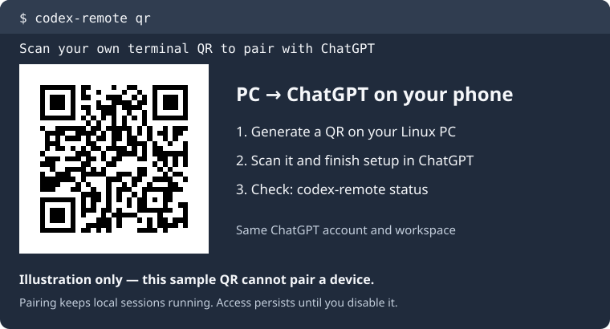

# Codex Remote — use Codex CLI from your phone

[](https://github.com/Cheaux/codex-remote/actions/workflows/ci.yml)
[](https://github.com/Cheaux/codex-remote/releases/latest)
[](LICENSE)

**Connect Codex running on your computer to the official ChatGPT phone app.** Generate a pairing QR, check connected devices, and manage remote access from your terminal or by asking Codex.

Use any operating system where Codex provides the required native managed-server remote interface. Linux is verified; macOS, Windows, and other operating systems are currently untested.

Codex Remote is a community plugin by [Cheaux](https://github.com/Cheaux). It uses Codex's native remote service and your existing ChatGPT sign-in. OpenAI does not maintain or endorse this plugin.

**[Step-by-step guide](https://cheaux.github.io/codex-remote/) · [Downloads](https://github.com/Cheaux/codex-remote/releases/latest) · [Troubleshooting](https://cheaux.github.io/codex-remote/troubleshooting/) · [Report a problem](https://github.com/Cheaux/codex-remote/issues/new/choose)**

## What can I do with it?

- Pair your phone by asking Codex: **“Show the QR for remote session pairing.”**
- Continue an existing Codex conversation from ChatGPT on your phone.
- Check remote connectivity and see paired devices.
- Disable remote access or revoke a specific device when you choose.

The plugin uses the existing Codex daemon. It preserves local conversations and existing pairings, requires no separate API key, and opens no additional network listener.

## Commands you will use

After [installing the plugin](#install-and-pair), use these commands in your regular terminal.

| Command | What it does |
| --- | --- |
| `codex-remote qr` | Show a fresh QR, phone link, manual code, and expiration. Enables access if needed. |
| `codex-remote status` | Check the remote relay and paired devices. |
| `codex-remote devices list` | Show device names and IDs. |
| `codex-remote devices revoke DEVICE_ID` | Remove the specific device you choose. |
| `codex-remote disable` | Turn off remote access while preserving local sessions and pairings. |
| `codex-remote enable` | Turn remote access back on. |

**Remote access stays enabled until you disable it.** Uninstalling the plugin does not turn off native remote access. If you want it off, run `codex-remote disable` first. Disabling access and removing a paired device are separate actions.

`pair` is an alias for `qr`. Commands support `--json` for scripts. [Full command reference](https://cheaux.github.io/codex-remote/commands/)



## Before you install

You need:

1. A computer on **any OS** with **[Node.js 24 or newer](https://nodejs.org/en/download)**, including npm, and Codex's required native managed-server remote interface. See the [testing status](#compatibility) below.
2. **[Codex CLI](https://learn.chatgpt.com/docs/cli/)** installed and signed in with ChatGPT. The tested Codex version is **0.163.0**.
3. The official ChatGPT app on your phone, using the **same account and workspace** as Codex. Account or workspace policies may restrict remote access.
4. An internet connection. Your PC must stay awake with Codex's managed server running while you use it remotely.

Check your installed versions in a regular terminal:

```sh
node --version
codex --version
```

The native remote interface is experimental. **Android pairing and existing-chat messaging have been verified.** See [compatibility](#compatibility) for the exact testing status.

## Install and pair

Run the commands for your shell in a regular terminal on your computer. The Bash/Zsh commands install into your user account without `sudo`.

**Bash / Zsh (Linux or macOS):**

```sh
export PATH="$HOME/.local/bin:$PATH"
curl --fail --location --output codex-remote-0.1.0.tgz \
  https://github.com/Cheaux/codex-remote/releases/download/v0.1.0/codex-remote-0.1.0.tgz
npm install --global --prefix "$HOME/.local" --ignore-scripts ./codex-remote-0.1.0.tgz
codex-remote install
codex-remote qr
```

**PowerShell (Windows, untested):**

```powershell
Invoke-WebRequest -Uri https://github.com/Cheaux/codex-remote/releases/download/v0.1.0/codex-remote-0.1.0.tgz -OutFile codex-remote-0.1.0.tgz
npm install --global --ignore-scripts .\codex-remote-0.1.0.tgz
codex-remote install
codex-remote qr
```

The PowerShell commands use npm's default global installation directory. Downloading the archive first also works with npm 12's default restriction on direct URL installs. Native Codex must expose the same managed-server remote interface; installation alone does not establish OS compatibility.

`codex-remote install` registers the plugin with Codex. `codex-remote qr` enables persistent remote access if needed and displays a short-lived pairing code.

1. Scan the QR with your phone's camera, or open the printed pairing link on your phone.
2. Complete the setup in ChatGPT with the same account and workspace.
3. Run `codex-remote status` on your PC to check connectivity and paired devices.
4. Open a **new Codex terminal** to load the conversational tools. You can leave your current conversations running.

In that new Codex conversation, try:

> Show the QR for remote session pairing.

You only need a fresh QR when pairing another device or replacing an expired code. For an existing connection, ask **“Check my remote connection”** instead.

If a new Bash/Zsh terminal cannot find `codex-remote`, add `export PATH="$HOME/.local/bin:$PATH"` to your shell's startup file. For PowerShell, check that npm's global executable directory is on PATH. The [installation guide](https://cheaux.github.io/codex-remote/install/) explains both paths.

## Can I type `/qr` inside Codex?

**Only with the separate Codex Folders terminal launcher.** Its integration adds `/qr` and autocomplete beside Codex's native suggestions, then returns you to your retained chat.

This standalone Remote release does not include that launcher. Without it, use `codex-remote qr` in a regular terminal or ask Codex conversationally. Native plugin installation alone does not register `/qr` as a built-in slash command.

## Compatibility

| Feature or platform | Status |
| --- | --- |
| Linux host, Node 24+, Codex 0.163.0 | Tested baseline |
| Android pairing and continuing an existing chat | Verified on a real phone |
| iPhone pairing | Uses the same native link; end-to-end verification pending |
| Creating a new chat from the phone | Verification pending |
| Mobile approvals and steering an active task | Verification pending |
| macOS or Windows hosts | Untested; requires a compatible native Codex managed-server remote interface |
| Other operating systems | Untested; requires Node 24+ and the same native interface |
| Sessions started with `--no-daemon` | Outside the shared server; not migrated by this plugin |

A connected relay does not prove a phone has paired. Check both `status` and `devices list`. The plugin makes native remote features easier to access; it cannot bypass account restrictions or add missing native mobile features.

## Update or uninstall

To update, use the installation command from the [latest release](https://github.com/Cheaux/codex-remote/releases/latest), then run `codex-remote install` again. Open a new Codex terminal to load updated tools.

To uninstall, first decide whether you also want native remote access disabled. If so, run `codex-remote disable`, then:

```sh
codex plugin remove codex-remote@codex-remote-local
codex plugin marketplace remove codex-remote-local
npm uninstall --global --prefix "$HOME/.local" codex-remote
```

These removal commands preserve native device pairings and remote preferences. [More troubleshooting and answers](https://cheaux.github.io/codex-remote/troubleshooting/)

On Windows, use the same two plugin removal commands, followed by `npm uninstall --global codex-remote` for the default-prefix installation above.

## How it works

The CLI and MCP tools use the existing managed Codex server's local Unix WebSocket. Enable/disable operations use `remoteControl/enable` and `remoteControl/disable` with `ephemeral: false`. They do not restart the daemon. When no daemon exists, an explicit enable/pairing request may start it.

Pairing credentials are short-lived and are not saved by this plugin. QR images and links grant access during pairing: keep real ones private. Codex Remote does not add its own analytics or remote server; native Codex and ChatGPT services still handle the connection.

`CODEX_HOME` selects the native Codex home. `CODEX_REMOTE_CODEX_BIN` can select a specific Codex executable. [Architecture, lifecycle, and privacy](https://cheaux.github.io/codex-remote/commands/#lifecycle-and-privacy)

Official references: [Codex app-server](https://learn.chatgpt.com/docs/app-server), [remote connections](https://learn.chatgpt.com/docs/remote-connections).

## Contributing

See [CONTRIBUTING.md](CONTRIBUTING.md) for local setup, checks, and the release workflow. Start with the [issue tracker](https://github.com/Cheaux/codex-remote/issues) for bugs or suggestions.

This project is licensed under [MIT](LICENSE).
